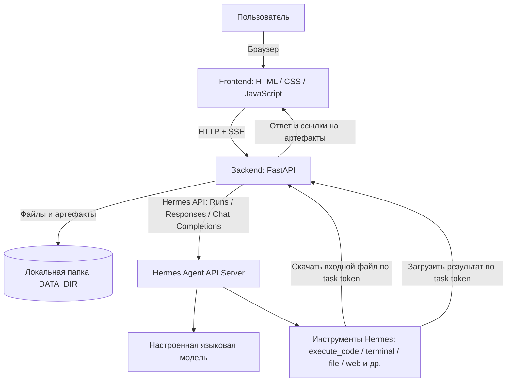
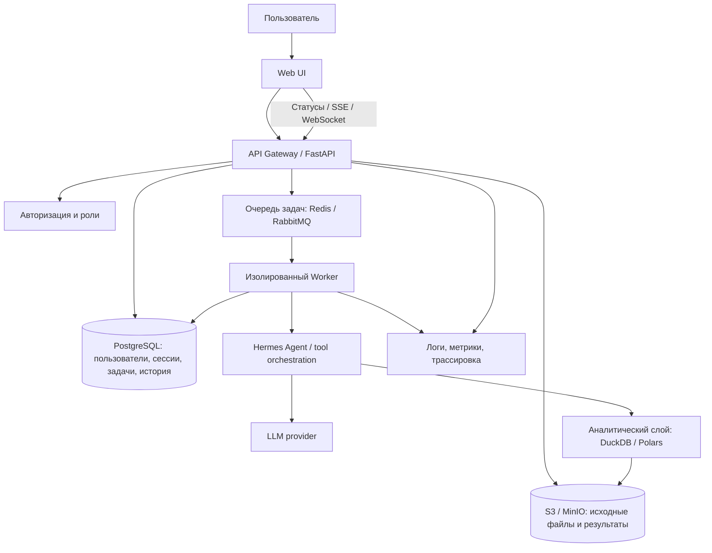

# Архитектура Hermes Chat

Документ описывает то, что реально реализовано в текущей версии, и вариант развития для более серьёзной эксплуатации. Это не описание уже существующих, но пока не написанных компонентов.

## 1. Что делает система

Hermes Chat — это веб-оболочка вокруг отдельно установленного Hermes Agent. Она отвечает за интерфейс, загрузку файлов, сессии чата, обмен файлами с агентом и показ результата. Сам анализ выполняет Hermes Agent и его инструменты.

Важно: приложение само по себе не включает инструменты агента. Наличие `execute_code`, `terminal` и остальных инструментов зависит от конфигурации Hermes Agent для платформы `api_server`.

## 2. Текущая архитектура

### Компоненты и технологии

| Часть | Что используется | За что отвечает |
|---|---|---|
| Веб-интерфейс | HTML, CSS, JavaScript без frontend-фреймворка | Чат, прикрепление файлов, предпросмотр таблиц, отображение ответов и артефактов |
| Веб-сервер frontend | Nginx `1.27-alpine` | Раздаёт статические файлы и проксирует API-запросы согласно конфигурации |
| Backend | Python 3.12, FastAPI `0.115.6`, Uvicorn `0.34.0` | REST API, сессии, загрузка файлов, SSE, проверка токенов и обмен артефактами |
| HTTP-клиент | HTTPX `0.28.1` | Подключение к Hermes API; для локальных адресов обходятся переменные системного proxy |
| Передача файлов | FastAPI UploadFile, локальная файловая система | Хранение загруженных файлов и результатов в `DATA_DIR` |
| Агент | Hermes Agent API Server | Управляет историей общения и вызовами собственных инструментов |
| Модель | Настраивается в Hermes; в проекте для интерфейса указана метка `pvx-ai-test:latest` | Формирует ответы и выбирает, когда вызывать доступные инструменты |
| Контейнеризация | Docker Compose v2 | Отдельно запускает frontend и backend |

### Как проходит запрос

1. Браузер обращается к backend и создаёт сессию.
2. Backend принимает файл, проверяет расширение и размер, сохраняет его в каталоге сессии. Для CSV/TSV определяется кодировка, разделитель, названия колонок, типы и число строк; в интерфейсе показывается небольшой preview.
3. При отправке вопроса backend блокирует параллельное выполнение в той же сессии и создаёт временный случайный токен задачи.
4. Hermes получает текст задачи и описание вложений. Когда агенту нужны байты файла, его инструменты забирают файл через специальный endpoint backend с этим токеном.
5. Hermes Agent выполняет вычисления доступными ему инструментами. Для локальных вычислений в промпте назначен `execute_code`, для сетевых операций и скачивания — `terminal`, для файловых операций — файловые инструменты.
6. Созданные агентом файлы загружаются назад в backend через отдельный endpoint с тем же токеном.
7. Backend принимает только финальный ответ Hermes, показывает его вместе с артефактами и завершает ход. Временный токен меняется, поэтому старый доступ к файлам больше не работает.

### Поддерживаемые режимы Hermes API

Backend сначала проверяет возможности API. При наличии используется Runs API с ожиданием состояния `completed`; затем предусмотрен путь через Responses API, а резервным вариантом служит Chat Completions без потоковой передачи. Для результата выбирается только финальный текст, а промежуточные сообщения и вывод инструментов не выдаются за ответ.

Для запуска передаётся ключ идемпотентности. При сетевой ошибке или HTTP 5xx задача автоматически не отправляется повторно: иначе можно случайно запустить один и тот же анализ дважды. Для продолжения беседы backend передаёт ключ сессии Hermes.

### Где хранятся данные и что теряется при перезапуске

- Файлы и артефакты находятся в `DATA_DIR`, по умолчанию — `./data` (в Docker Compose каталог подключается как `/data`).
- Список активных сессий, история чата и индексы файлов в текущей реализации находятся в оперативной памяти процесса.
- Поэтому после перезапуска backend файлы могут физически остаться на диске, но прежние сессии не восстанавливаются. Для демонстрационного запуска это допустимое упрощение; для постоянной эксплуатации — ограничение.

### Ограничения текущей реализации

1. **Нет отдельной базы данных.** Сессии и история чата не переживают перезапуск backend.
2. **Нет очереди заданий.** Долгая задача обрабатывается в процессе API; для одной сессии разрешён только один активный ход.
3. **Нет собственной аналитической СУБД.** Табличные вычисления выполняются инструментами Hermes Agent в его среде. Hermes должен иметь корректно включённые инструменты и библиотеки.
4. **Ограничение загрузки — 20 МБ по умолчанию.** Его можно изменить через `MAX_UPLOAD_MB`. При первичном профилировании CSV целиком читается в память, поэтому для больших файлов требуется запас RAM. Потоковая обработка пока не реализована.
5. **Один локальный контур доверия.** Авторизация конечных пользователей и разделение ролей не реализованы. Не следует публиковать интерфейс или Gateway для недоверенных пользователей.
6. **Общий CORS по умолчанию.** Для реального развёртывания задайте конкретные `CORS_ORIGINS` и защитите API.
7. **Обмен с агентом зависит от сетевой доступности callback URL.** Если инструменты выполняются не на том же хосте, адрес `HERMES_CALLBACK_BASE_URL` должен быть достижим из их среды.

## 3. Идеальная архитектура для развития

Ниже — целевая схема, а не то, что уже входит в текущий архив.

### Что стоит изменить

- **Хранить состояние отдельно от процесса.** PostgreSQL — для пользователей, сессий, истории сообщений, задач и статусов; объектное хранилище S3/MinIO — для исходных данных и файлов результатов.
- **Вынести тяжёлую работу из API.** API принимает запрос и ставит задачу в очередь, worker исполняет её независимо. Это позволяет переживать перезапуски и ограничивать параллелизм.
- **Выделить аналитический контур.** DuckDB или Polars для SQL/columnar-анализа CSV и Parquet; согласованный слой метрик для выручки, возвратов, SLA и других бизнес-показателей. Агент формирует план анализа и вызывает строго определённые инструменты, а не получает неограниченный доступ к системе.
- **Изолировать выполнение.** Отдельный контейнер/worker на задачу, лимиты CPU/RAM/времени, read-only доступ к исходным файлам и контролируемый каталог результатов.
- **Добавить контроль доступа.** Пользователи, роли, права на датасеты и результаты, короткоживущие ссылки, аудит обращений.
- **Сделать вычисления воспроизводимыми.** Сохранять SQL/код анализа, версию датасета, параметры фильтров, версии модели и инструментов, промежуточные агрегаты и итоговый артефакт.
- **Добавить наблюдаемость.** Статус каждого этапа, длительность, количество токенов, вызовы инструментов, использованные файлы, ошибки и причины повторного запуска.
- **Реализовать потоковую загрузку.** Не держать большой CSV полностью в памяти API; вычислять preview и профиль потоково, а обработку передавать аналитическому worker.

## 4. Стек: сейчас и целевой

| Слой | Сейчас | Целевой вариант |
|---|---|---|
| Frontend | HTML / CSS / Vanilla JS | Текущий frontend можно сохранить; при росте интерфейса — React/Vue/TypeScript |
| API | FastAPI + Uvicorn | FastAPI с отдельными API-модулями и схемами |
| Agent orchestration | Hermes Agent API Server | Hermes Agent + контролируемый набор аналитических tools |
| Аналитика | Инструменты Hermes Agent | DuckDB + Polars; SQL как проверяемая форма запроса |
| Метаданные | In-memory | PostgreSQL |
| Файлы | Локальный `DATA_DIR` | S3 / MinIO |
| Очереди | Нет | Redis/RQ, Celery или RabbitMQ worker |
| Развёртывание | Docker Compose | Compose для малого контура; Kubernetes — только при реальной потребности в масштабировании |
| Мониторинг | Логи приложения | Структурированные логи, OpenTelemetry, Prometheus/Grafana |

## 5. Итог

Текущая версия — рабочий прототип интерфейса и интеграционного слоя с Hermes Agent, а не готовая многопользовательская BI-платформа. Главная проверяемая часть — корректно передать агенту файл и задачу, получить реальное выполнение инструментов и показать только подтверждённый финальный результат. Для перехода к промышленной системе в первую очередь нужны постоянное хранилище состояния, очередь задач, потоковая работа с большими файлами, аналитический слой и безопасность доступа.
